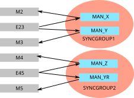

.. currentmodule:: karahoff

KaraHoff --- a Karabo driver for EtherCAT PLCs
==============================================

KaraHoff is the glue code between `EBPFCat <https://github.com/tecki/ebpfcat>`_
and `Karabo <https://www.karabo.eu>`_. It allows to run an entire EtherCAT PLC
from Karabo directly.

Concepts
--------

KaraHoff stores all data within Karabo projects. The entire configuration is
done via Karabo devices.

The EtherCAT loop is directly connected to an ethernet port on the computer
KaraHoff is running on. It is controlled by Karabo device servers, which run an
:class:`~master.EtherCATMaster`. An EtherCAT loop may be shared between several
device servers, however each terminal should only ever be used by one device
server.

Each terminal that one wants to use is represented by a Karabo device, most
often :class:`~terminals.GenericTerminal` is good enough. In that device one
needs to specify the terminal type, which needs to be supported by EBPFCat. The
terminal is identified by its serial number, which is usually set to the XFEL
QR code number. The :class:`~master.EtherCATMaster` contains all functionality
to store the QR code number into a terminal.

The functionality of the PLC is provided by devices which use the terminals.
One terminal may be used for several devices, as well as a device may use
several terminals.

A group of devices is then combined into a **sync group**. The sync group
assures that there is regular communication with all the terminals used by its
devices. In order to do that properly, the sync group effectively takes
ownership of a terminal: only one running sync group should ever write to a
terminal.

   A simple example for sync groups: on the left are the terminals, M stands
   for motor, E for encoder. There are two sync groups, each containing two
   motors which use the terminals. Note that each sync group has its own group
   of terminals. All mentioned elements are Karabo devices, held together by
   a master device (not shown), which is also a Karabo device.

How to add a new terminal
-------------------------

You may add a new terminal into the loop as described by Beckhoff, by
connecting the necessary EtherNET or EtherCAT cables, or by adding the terminal
into an existing row of terminals. This may even be done while the system is
running.

When you now click *Scan Bus* in the EtherCAT master device, it will find
your additional terminals, and they will show up in the list of serial numbers,
if a serial number (at XFEL, usually the QR code) has been set. If not, it will
show up with a negative number indicating the position in the loop.

If no serial number has been set, one should set one. Given that the terminal
will only show up by its position, it is advisable to use a small loop to
program the serial number, such that the new terminal can easily be found. Then
one writes the negative number into the *Target Terminal*, the serial number
(at XFEL, the QR code, register the terminal in XIM if necessary) into *Target
Serial Number*, click *Write Serial Number*, and the serial number will be
stored in the terminal.

Then we add a device in the loop with the type *Generic Terminal* or with a
type of the specific terminal, if there is one. As a name, use ``/TERM/`` in
the middle of the Karabo name to indicate a terminal. In the new device you
need to enter the EtherCAT master device the terminal should belong to, and the
terminal's, serial number, so the device can find it, and the *terminalType*
for *Generic Terminal*\ s.

Example: how to add a motor
---------------------------

Stepper motors are a good example on how devices are added in KaraHoff, as they
are sufficiently complex to show all steps necessary. Other devices (valves,
gauges, ...) are simpler and work much similar. Let's go step by step:

- find a free motor terminal, if the motor has not already been connected. You
  may add one, like a Beckhoff EL7041 to the loop, proceed as described above
- find a free channel on an encoder terminal, like an EL5042, again, if needed
  add a terminal.
- add a new device of type *Motor* to the Karabo project.
- In that device, set the name of the motor terminal.
- In that device, also set the channel on the encoder terminal, giving the name
  of the terminal, and the name of the channel, combined with a dot, as in
  ``INSTRUMENT_TEST_PLC/TERM/PM5.channel2``.
- Decide which sync group this motor should belong to: either add a new
  *Fast Sync Group* device, or choose an existing one.
- For a new sync group, set the master device to the one it should belong to.
- Shut down an existing sync group (evidently it will stop working), and add
  your new motor to its *devices* list.

Troubleshooting
---------------

Should a device get stuck, or should it be needed to be configured differently,
it may be safely shut down. Note that upon restarting it, the sync group the
device belongs to also needs to be restarted. Restarting a sync group means
that all terminals go into a safe state, e.g. all valves of a vacuum system
usually close.

Should a device really not work anymore, it may be advisable to shut down its
sync group and remove the device from the list of the sync group's members.

If all fails, one may restart the device server. Unfortunately that is often
not possible using the normal shutdown button, but the **Service Manager** in
the GUI should work. Once the device server is restarted, one may safely
instantiate all devices. Note that the instantiation may be slow, in which case
the GUI shows many errors of delayed instantiation, do not worry, just ignore
them.

The available devices
---------------------

.. automodule:: karahoff.devices

The devices that hold KaraHoff together
---------------------------------------

.. automodule:: karahoff.terminals

.. automodule:: karahoff.master
